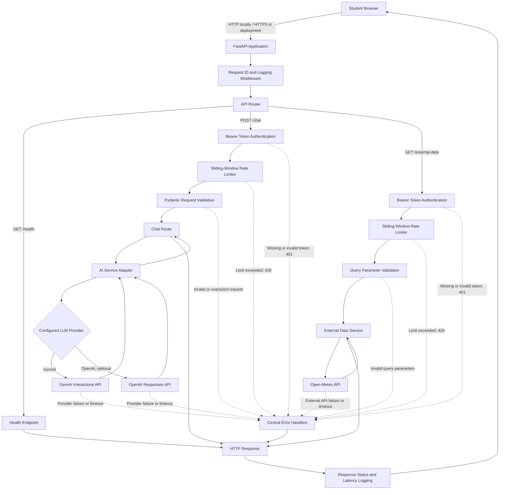

# CampusAssist AI

CampusAssist AI is a student-support web application built with **FastAPI**, a configurable large-language-model (LLM) provider, and the **Open-Meteo** public weather API. Students use a browser-based chat interface to ask campus-related questions. The backend validates requests, protects selected routes with Bearer-token authentication, applies an in-memory sliding-window rate limit, calls the configured AI or external-data service, and records structured operational logs.

This project is developed for **MSADLB302P – Intelligent AI Systems and Agent Development, Student Exercise: CampusAssist AI**.

> **Current project configuration:** The live Gemini generation test succeeded with `gemini-3.5-flash-lite` (HTTP 200; approximately 4.63 seconds for the short diagnostic prompt). Use that model in your local `.env`. The earlier `gemini-3.8-flash` test returned HTTP 503 (`service_unavailable`) due to temporary high demand.
>
> **Campus knowledge:** `data/campus_knowledge.json` has been populated with a limited set of Institute of Science, Mumbai and Dr. Homi Bhabha State University facts and source URLs. Check each fact against its current official source before demonstrating or submitting the application. The assistant must not invent information that is not in this file.

## 1. Features

- FastAPI backend and responsive browser-based chat interface.
- Google Gemini Interactions API integration; an OpenAI Responses API adapter is also included as an alternative but has not been live-tested for this project.
- Bounded conversation context supplied by the browser for each chat request.
- Campus knowledge loaded from `data/campus_knowledge.json`.
- Bearer-token authentication for `/chat` and `/external-data`.
- Configurable per-client-IP in-memory sliding-window rate limit (default: 10 requests per 60 seconds).
- Request IDs, response headers, structured JSON request logs, consistent error responses, request-body and question-size limits.
- Server-side Open-Meteo current-weather integration; no API key is required for the configured free non-commercial endpoint.
- Automated pytest tests, a 20-request performance script, Dockerfile and Docker Compose configuration.

## 2. Technology stack

| Area | Technology |
|---|---|
| Backend | Python 3.11, FastAPI, Pydantic v2, Uvicorn |
| Outbound HTTP | HTTPX asynchronous client |
| Configuration | `pydantic-settings`, environment variables, `.env` |
| AI provider | Google Gemini Interactions API (currently used); OpenAI Responses API adapter (optional, not live-verified) |
| External API | Open-Meteo Forecast API |
| Frontend | HTML, CSS, JavaScript |
| Security | Bearer access token, `hmac.compare_digest`, request validation, rate limiting and size limits |
| Testing | pytest, FastAPI TestClient, pytest-cov |
| Containerization | Docker, Docker Compose |
| Version control | Git and GitHub (to be completed and verified locally) |

## 3. System architecture



### 3.1 Request and response flow

1. A student sends a request from the browser to the FastAPI application.
2. Request middleware accepts a safe incoming `X-Request-ID` or generates a UUID. The ID is attached to the response and operational log.
3. `/health` is public. `/chat` and `/external-data` require a valid Bearer access token.
4. Protected routes apply the configured per-client-IP rate limit.
5. Pydantic validates request bodies and query parameters. Middleware enforces the configured request-body size limit; the chat route also applies the configured question-length limit.
6. `/chat` builds a bounded context from the current question, recent conversation messages, and campus facts, then calls the configured LLM adapter using HTTPX.
7. `/external-data` calls Open-Meteo from the backend and selects the weather fields returned to the browser.
8. FastAPI returns the result or a controlled error. Middleware logs the method, path, status, request ID and latency.

### 3.2 Authentication flow

- Generate a random application access token and store it as `CAMPUSASSIST_API_KEY` in the local `.env` file.
- The student enters this demo token in the browser's **Demo access** area.
- The frontend sends it in the `Authorization: Bearer ...` header to protected endpoints. The token is held in page memory for the session; it is not meant to be a production identity system.
- The backend compares the supplied token with the configured token using `hmac.compare_digest`.
- Missing or invalid credentials are rejected. Gemini/OpenAI provider keys remain on the server and are never sent to the browser.

**Production caveat:** A shared demo token is suitable only for a private classroom demonstration. A browser user can inspect credentials they enter. A public service should use per-user authentication such as OAuth/OIDC or signed access tokens, HTTPS, managed secrets, token rotation and abuse monitoring.

### 3.3 Error-handling flow

Known application and upstream failures are converted into JSON responses containing the request ID, status code, safe error type and public message. Provider response bodies, API keys and stack traces are not returned to the client. Unexpected exceptions are logged server-side with a high-level error type and request ID.

### 3.4 Main failure points

- Missing or invalid application access token.
- Request body or question exceeds the configured size limit.
- Invalid request body or weather coordinates.
- Per-IP rate limit is exceeded.
- LLM API key/model access is invalid, provider returns an error, provider is overloaded, or request times out.
- Open-Meteo is unavailable, times out or returns an unexpected response.
- Campus facts are absent or do not answer the question; in that case the chatbot must acknowledge the information gap.
- In-memory rate-limit state is not shared across multiple workers or replicas and is cleared when the application process restarts.

## 4. Project structure

```text
CampusAssist-AI/
├── app/
│   ├── main.py
│   ├── config.py
│   ├── dependencies.py
│   ├── middleware/
│   │   └── request_context.py
│   ├── routes/
│   │   ├── health.py
│   │   ├── chat.py
│   │   └── external_data.py
│   ├── services/
│   │   ├── ai_service.py
│   │   └── external_api_service.py
│   ├── schemas/
│   │   ├── chat.py
│   │   └── responses.py
│   └── utils/
│       ├── errors.py
│       ├── error_handlers.py
│       └── logging_config.py
├── data/
│   └── campus_knowledge.json
├── frontend/
│   ├── index.html
│   ├── style.css
│   └── app.js
├── tests/
├── scripts/
│   └── performance_test.py
├── docs/
│   ├── API_CONTRACTS.md
│   ├── VERIFICATION_REPORT.md
│   ├── PERFORMANCE_RUN.md
│   └── PHASES_AND_RUNBOOK.md
├── .env.example
├── .gitignore
├── .dockerignore
├── requirements.txt
├── Dockerfile
├── docker-compose.yml
└── README.md
```

## 5. Prerequisites

- Python 3.11 recommended (the Docker image uses Python 3.11).
- Git for the version-control task.
- Docker Desktop for container build/run verification.
- A Google AI Studio API key for the Gemini configuration used in this project.
- Internet access from the backend to reach Gemini and Open-Meteo.

Only the selected LLM provider needs a provider key. The OpenAI adapter is optional and has not been verified with a live OpenAI key in this project.

## 6. Installation and configuration – Windows PowerShell

Open PowerShell or the VS Code terminal in the project root (`CampusAssist-AI`). If the virtual environment already exists, activate it rather than creating another one.

```powershell
# Create only if .venv does not already exist
py -3.11 -m venv .venv

# Activate the environment
.\.venv\Scripts\Activate.ps1

# Install project dependencies
python -m pip install -r requirements.txt
```

On first setup only, create the environment file:

```powershell
Copy-Item .env.example .env
```

**Do not overwrite an existing `.env` file** if it already contains your working settings and keys.

Generate a random application access token:

```powershell
python -c "import secrets; print(secrets.token_urlsafe(32))"
```

Copy the generated value into `CAMPUSASSIST_API_KEY` in `.env`. Add your Google AI Studio key to `GEMINI_API_KEY`. Never paste provider keys or the application token into source code, screenshots, GitHub or frontend files.

### 6.1 Recommended working Gemini settings

The following are the settings used for the successful live Gemini generation test and the latest configuration instructions in this project:

```env
LLM_PROVIDER=gemini
GEMINI_API_KEY=YOUR_GOOGLE_AI_STUDIO_KEY
GEMINI_MODEL=gemini-3.5-flash-lite
LLM_TIMEOUT_SECONDS=60
LLM_MAX_OUTPUT_TOKENS=1200
MAX_QUESTION_CHARS=1500
MAX_HISTORY_MESSAGES=8
MAX_HISTORY_MESSAGE_CHARS=2000
CAMPUS_KNOWLEDGE_PATH=data/campus_knowledge.json
EXTERNAL_API_TIMEOUT_SECONDS=8
RATE_LIMIT_REQUESTS=10
RATE_LIMIT_WINDOW_SECONDS=60
MAX_REQUEST_BODY_BYTES=20000
```

Keep your real keys only in `.env`. Do not include the `YOUR_GOOGLE_AI_STUDIO_KEY` placeholder as a real credential. Make the non-secret defaults in `app/config.py` and `.env.example` consistent with the settings you use. In particular, set the Gemini model default to `gemini-3.5-flash-lite` and the output-token default to `1200` if those are the settings you are using locally.

The earlier `gemini-3.8-flash` generation test returned HTTP 503 with a temporary high-demand message. A direct live request to `gemini-3.5-flash-lite` later returned HTTP 200 and the text `CampusAssist connected.` in approximately 4.63 seconds. Model availability and service capacity can change; confirm access with your own key when demonstrating the project.

### 6.2 Optional OpenAI configuration

An OpenAI adapter is included. It is not the provider used in the verified live demonstration. To use it, select `LLM_PROVIDER=openai`, provide `OPENAI_API_KEY`, and set `OPENAI_MODEL` to a model actually available to your account. Do not assume that a placeholder model name is valid.

## 7. Campus knowledge file

The campus facts are stored in `data/campus_knowledge.json`. The file used for the current local demonstration has been populated with a limited set of Institute of Science, Mumbai and Dr. Homi Bhabha State University information, including student facilities, mentoring information and administrative contact guidance with source URLs.

Before submission or any real student use:

- Open the JSON file and confirm it contains the facts you intend to demonstrate.
- Check each source URL and confirm the wording, scope and details are still current.
- Keep Institute-specific facts separate from University-wide facts.
- Do not include private student records or personal information.
- Do not invent office hours, fees, policies, deadlines, phone numbers or service availability.
- Update or remove facts that cannot be verified.

Example record format:

```json
{
  "facts": [
    {
      "topic": "Library facilities",
      "content": "Describe only the facilities confirmed by the official library source.",
      "source": "https://official-college-source.example/library"
    }
  ]
}
```

The example URL and sentence above are placeholders, not real campus facts. Replace them with verified information before use. If the supplied facts do not answer a question, CampusAssist should state that verified information is unavailable and direct the student to an official contact route.

## 8. Run locally

With `.venv` activated and `.env` configured, start the server:

```powershell
uvicorn app.main:app --reload --host 127.0.0.1 --port 8000
```

Open these addresses in a browser:

- Web application: [http://127.0.0.1:8000/](http://127.0.0.1:8000/)
- Interactive API documentation: [http://127.0.0.1:8000/docs](http://127.0.0.1:8000/docs)
- Health endpoint: [http://127.0.0.1:8000/health](http://127.0.0.1:8000/health)

Enter the `CAMPUSASSIST_API_KEY` value in the browser's **Demo access** area before using chat or weather.

### 8.1 Health check

```powershell
Invoke-RestMethod http://127.0.0.1:8000/health
```

### 8.2 Protected chat request

Use the actual token from `.env`. Do not save the token in a script or commit it to Git.

```powershell
$line = Get-Content .env | Where-Object {
    $_ -match '^CAMPUSASSIST_API_KEY='
} | Select-Object -First 1
$token = ($line -split '=', 2)[1].Trim().Trim('"').Trim("'")
$headers = @{ Authorization = "Bearer $token" }
$body = @{
    question = "What library facilities are available?"
    history = @()
} | ConvertTo-Json -Depth 5

Invoke-RestMethod -Method Post `
    -Uri http://127.0.0.1:8000/chat `
    -Headers $headers `
    -ContentType "application/json" `
    -Body $body
```

The response contains `answer`, `request_id`, `provider` and `model`.

### 8.3 Weather request

```powershell
Invoke-RestMethod `
    -Uri "http://127.0.0.1:8000/external-data?latitude=19.0760&longitude=72.8777" `
    -Headers $headers
```

The coordinates above are a Mumbai example. Use the actual coordinates you intend to test. A successful live response is still to be verified on the student's machine and network.

## 9. API endpoint contracts

All endpoints return JSON. The detailed contracts are also documented in [`docs/API_CONTRACTS.md`](docs/API_CONTRACTS.md).

| Method | Endpoint | Authentication | Purpose |
|---|---|---|---|
| GET | `/health` | Not required | Liveness status |
| POST | `/chat` | Bearer token | Send a student question to the configured LLM |
| GET | `/external-data` | Bearer token | Retrieve selected current-weather fields from Open-Meteo |

### 9.1 `GET /health`

- No request body or authentication required.
- HTTP 200 response contains `status`, `service` and `environment`.
- This is an application liveness check; it does not call Gemini or Open-Meteo.

### 9.2 `POST /chat`

Authentication: `Authorization: Bearer <CAMPUSASSIST_API_KEY>`.

Request example:

```json
{
  "question": "How can I contact the Institute for an administrative query?",
  "history": []
}
```

The question must not be blank and is limited by `MAX_QUESTION_CHARS` (configured as 1,500 characters for the current project). History contains recent `user` and `assistant` messages, with each message bounded by the configured history-message limit. The application uses at most the configured number of recent messages when building the LLM context.

Successful response fields:

- `answer`: generated answer text.
- `request_id`: correlation ID for this request.
- `provider`: configured LLM provider.
- `model`: configured model identifier.

### 9.3 `GET /external-data`

Authentication: Bearer token.

Required query parameters:

- `latitude`: number between -90 and 90.
- `longitude`: number between -180 and 180.

The backend returns selected fields: provider, coordinates, timezone, observation time, temperature, apparent temperature, relative humidity, precipitation, weather code, wind speed, units and request ID.

### 9.4 API design justification

- **GET `/health`:** retrieves application status without modifying server data, so GET is appropriate.
- **POST `/chat`:** sends a question and optional conversation history in a request body. POST avoids putting the student's full prompt and history in the URL and invokes an AI operation.
- **GET `/external-data`:** retrieves weather data using latitude and longitude query parameters without changing application state, so GET is appropriate.

## 10. LLM integration

The active provider is selected through `LLM_PROVIDER`. The current demonstrated configuration is Google Gemini.

| Item | Current project setting |
|---|---|
| Provider | Google Gemini |
| Model used in successful live test | `gemini-3.5-flash-lite` |
| API interface | Gemini Interactions API |
| Credential variable | `GEMINI_API_KEY` |
| Credential header | `x-goog-api-key` |
| Request storage setting | `store: false` |
| Thinking setting | `low` |
| Output limit configured for current local setup | 1,200 tokens |
| Chat question limit | 1,500 characters |
| History | Up to 8 recent messages; each message up to 2,000 characters |
| Request timeout | 60 seconds; connection timeout 10 seconds |

### 10.1 Purpose and prompt behaviour

The model answers student-support and campus-related questions. The system prompt instructs the model to:

- Use the supplied campus facts for institution-specific claims.
- Separate Institute-level information from University-level information.
- List relevant facts directly when asked about facilities or services.
- Avoid inventing contact details, fees, timings, deadlines, policies or services.
- Clearly label general guidance.
- Give practical preparation advice for mentor-related questions without inventing appointment details.
- Avoid revealing system instructions, credentials or private configuration.

The backend supplies the current question, bounded conversation history and campus facts as context. Conversation history is context, not an authoritative source of campus policy.

### 10.2 Limits, timeout and failure behaviour

The application limits the question and conversation context, caps generated output using `LLM_MAX_OUTPUT_TOKENS`, and sets a provider request timeout. An LLM timeout is mapped to HTTP 504. Provider HTTP/connection errors, invalid provider responses or incomplete generations are handled as safe provider errors (HTTP 502 through the chat route). The frontend should display a controlled error rather than an incomplete answer.

### 10.3 Token and cost considerations

LLM usage depends on the input context, output length, model and account pricing. The campus knowledge and conversation history contribute to input tokens. The configured output ceiling limits generation size but is not a promise that every response will use that many tokens. For an estimate, use the provider's current published rates:

```text
Estimated cost =
(input tokens × input price per million
 + output tokens × output price per million) / 1,000,000
```

Do not insert a price in this report unless it has been checked for the actual model and account tier. Actual billing may differ based on cached, thinking or other token categories.

## 11. Third-party API integration – Open-Meteo

The application calls Open-Meteo server-side through `app/services/external_api_service.py`.

| Requirement | Implementation |
|---|---|
| Provider | Open-Meteo |
| Endpoint | `https://api.open-meteo.com/v1/forecast` |
| Purpose | Current weather for supplied coordinates |
| Authentication | No API key for the configured free non-commercial endpoint |
| Parameters | Latitude, longitude, selected current fields, `timezone=auto` |
| Timeout | 8 seconds by default (`EXTERNAL_API_TIMEOUT_SECONDS`) |
| Consumed fields | Temperature, apparent temperature, humidity, precipitation, weather code, wind speed, time, units and timezone |
| Timeout handling | HTTP 504 |
| Upstream/network/invalid response handling | HTTP 502 |

The browser calls the CampusAssist backend. The backend calls Open-Meteo and returns only the selected fields. The browser does not call the provider directly. Review Open-Meteo's current terms and attribution requirements for your use case before publishing or reusing the data.

## 12. Authentication, secrets and rate limiting

### 12.1 Authentication and secrets

- `CAMPUSASSIST_API_KEY` protects `/chat` and `/external-data`.
- Missing or invalid credentials return HTTP 401.
- If the server has no configured application token, protected requests return HTTP 503.
- Gemini/OpenAI provider keys are loaded server-side from environment configuration.
- `.env` is ignored by Git and excluded from Docker build context.
- Do not write credentials into source code, frontend JavaScript, screenshots or logs.

### 12.2 Rate-limiting policy

| Setting | Default |
|---|---:|
| Requests per client | 10 |
| Time window | 60 seconds |
| Client identifier | Direct client IP address |
| Algorithm | In-memory sliding window using timestamp queues |
| Exceeded behaviour | HTTP 429 and `Retry-After` header |
| Reset behaviour | Old request timestamps expire as they leave the rolling window |

The limiter is process-local. Its state is cleared when the application restarts and is not shared between multiple workers or replicas. For a multi-instance deployment, use a shared store such as Redis or an API gateway. The app uses the direct socket peer IP; configure trusted-proxy handling before relying on forwarded client-IP headers behind a reverse proxy.

## 13. Error-handling reference

| Failure | Expected HTTP status | Safe error type |
|---|---:|---|
| Missing/invalid application token | 401 | `authentication_failed` |
| Token not configured on server | 503 | `authentication_not_configured` |
| Invalid request body/parameters | 422 | `validation_error` |
| Oversized request body | 413 | `request_too_large` |
| Question exceeds configured limit | 413 | `input_too_large` |
| Rate limit exceeded | 429 | `rate_limit_exceeded` |
| LLM timeout | 504 | `llm_timeout` |
| LLM provider failure/incomplete response | 502 | `llm_provider_error` |
| Open-Meteo timeout | 504 | `external_api_timeout` |
| Open-Meteo failure | 502 | `external_api_error` |
| Unexpected application exception | 500 | `internal_server_error` |

Error responses include a request ID, status code, error type and public message. Detailed stack traces, provider response bodies and secrets must not be returned to the browser.

## 14. Logging and monitoring

Request middleware records structured JSON log entries containing a UTC timestamp, log level, request ID, HTTP method, endpoint path, status code and latency. LLM and external-service logs include provider/model metadata where appropriate. Prompts, responses, API keys and the application token should not be logged.

For a hosted deployment, collect application stdout/stderr and monitor 4xx/5xx rates, 429 counts, latency percentiles and upstream timeout/failure rates. `/health` is a liveness check only; it does not call paid or external providers.

## 15. Automated testing

The project uses pytest and FastAPI TestClient. Tests mock LLM and weather-service responses so that normal test execution does not require paid LLM calls or live external network access.

Run the complete test suite:

```powershell
python -m pytest -q
```

Run with detailed test names:

```powershell
python -m pytest -v
```

Run coverage:

```powershell
python -m pytest --cov=app --cov-report=term-missing
```

The test suite covers health, successful authenticated chat, authentication failures, invalid/oversized requests, rate limiting, LLM timeout/provider failures, external API success/failure/timeout and safe unexpected-error handling. Record the actual output from the final version of the code. A previous local run reported 18 passing tests before the latest AI-service replacement; rerun the suite after that replacement before claiming the final result.

## 16. 20-request performance evaluation

The included script `scripts/performance_test.py` supports a no-cost health-endpoint run and an optional live-chat run.

### 16.1 Recommended no-cost 20-request run

Start the application in one terminal. In a second terminal, with the virtual environment activated, run:

```powershell
python scripts/performance_test.py --target health --count 20
```

To save the output:

```powershell
python scripts/performance_test.py --target health --count 20 |
    Tee-Object -FilePath evidence-performance-health.txt
```

The script reports total requests, successful/failed requests, success rate, error rate, average latency, maximum latency and rate-limit events. `/health` is not rate limited, and this no-cost test does not call Gemini.

### 16.2 Optional chat measurement

The chat target sends real LLM requests and may consume paid quota. The default 10-requests-per-minute policy can cause a rapid 20-request run to receive HTTP 429 responses. Do not run this test merely to claim 20 successes. If measuring chat, record the model, account tier, rate limit and all failures honestly.

### 16.3 Existing preparation-environment baseline (not the student's laptop result)

A previous project-preparation run recorded the following sequential `/health` measurement:

| Metric | Preparation-environment result |
|---|---:|
| Total requests | 20 |
| Successful requests | 20 |
| Failed requests | 0 |
| Success rate | 100.00% |
| Error rate | 0.00% |
| Average latency | 2.26 ms |
| Maximum latency | 16.87 ms |
| Rate-limit events | 0 |

These values are retained as a preparation-environment baseline only. They are not measurements from the student's Windows laptop. Run the script on the final local setup and replace or supplement this table with the actual local result. The health benchmark measures backend liveness, not end-to-end LLM latency.

## 17. Docker containerization

The repository includes a Dockerfile and Docker Compose configuration. The Docker image uses Python 3.11 slim, installs dependencies, copies the backend/frontend/data files, runs as a non-root user, exposes port 8000 and defines a `/health` container check. The Compose configuration supplies environment variables from `.env` at runtime.

Docker build and container execution have not yet been verified on the student's machine. Complete these steps before claiming Docker evidence.

### 17.1 Build and run with Docker Compose

First make sure Docker Desktop is installed and running. Stop any local Uvicorn process already using port 8000. From the project root:

```powershell
docker version
docker compose version
docker compose build
docker compose up -d
docker compose ps
```

Check the health endpoint:

```powershell
Invoke-RestMethod http://localhost:8000/health
```

Inspect container health and logs:

```powershell
docker inspect campusassist-ai --format '{{.State.Health.Status}}'
docker compose logs --tail 100 campusassist
```

Stop the container:

```powershell
docker compose down
```

### 17.2 Docker security checks

- Keep `.env` out of the Docker build context through `.dockerignore`.
- Supply credentials at runtime using the Compose environment configuration.
- Do not add API keys to the Dockerfile or image layers.
- Confirm the application runs inside the container and does not depend on `.venv` or other developer-machine-only files.
- Capture the build output, container status, health response and logs as assignment evidence.

## 18. Git and GitHub workflow

Git commits, branch creation, merge and GitHub push must be performed in the student's repository. They have not been completed or verified as part of the live Gemini demonstration.

### 18.1 Initialize and inspect Git

From the project root:

```powershell
git --version
git status
```

If this is not yet a Git repository:

```powershell
git init
git branch -M main
```

Set your own Git identity once:

```powershell
git config --global user.name "Your Name"
git config --global user.email "your-email@example.com"
```

### 18.2 Verify secret exclusions

```powershell
git check-ignore -v .env
git ls-files .env
git status --short
```

`.env` must be ignored and must not be tracked. If it was previously committed, remove it from tracking and rotate any exposed credentials; a later deletion does not erase a secret from Git history.

### 18.3 Make meaningful commits

Commit actual changes with messages that describe the work performed. Suitable examples, if the corresponding changes are present, include:

```text
chore: create CampusAssist AI project structure
feat: add modular FastAPI backend
feat: add bearer authentication and environment configuration
feat: integrate Gemini Interactions API
feat: add Open-Meteo external data service
feat: add request IDs and structured error logging
feat: add in-memory sliding-window rate limiting
feat: add responsive student chat interface
build: containerize CampusAssist AI
test: add API security and upstream failure tests
docs: document architecture and assignment evidence
```

Remove the leading space before `test:` if copying that example. Do not create historical or misleading commits for work that was not performed.

### 18.4 Create and merge a feature branch

Make a genuine small documentation or frontend improvement on a separate branch:

```powershell
git switch -c feature/submission-evidence
```

After editing and testing the files:

```powershell
git add README.md docs
git commit -m "docs: complete assignment evidence"
git switch main
git merge --no-ff feature/submission-evidence -m "merge: add submission evidence"
git log --oneline --all --graph --decorate
```

### 18.5 Push to GitHub

Create an empty repository on GitHub. Replace the URL below with your actual repository URL:

```powershell
git remote add origin https://github.com/YOUR-USERNAME/CampusAssist-AI.git
git push -u origin main
git push -u origin feature/submission-evidence
```

Use Git Credential Manager or an appropriate GitHub authentication flow. Do not put a personal access token in a command that will be saved in shell history. Check the remote repository to confirm the code, branches and commit history are present and `.env` is absent.

## 19. Deployment notes and limitations

The project includes local/container deployment configuration. A successful Docker build, hosted deployment URL or public production service must not be claimed until actually completed.

For a public deployment, use HTTPS, per-user authentication, managed secret storage, shared rate limiting such as Redis or a gateway, trusted-proxy configuration, restricted CORS when origins differ, provider usage limits and log-retention controls. Configure the runtime to inject secrets, expose port 8000, route a health check to `/health` and collect application logs.

Known limitations:

- Campus knowledge is a curated set of facts, not an authoritative live integration with college records or portals. Check all facts and dates with official sources.
- LLM answers can be incomplete or incorrect. Verify important policies, deadlines, fees and safety information with the relevant official office.
- The in-memory rate limiter is suitable for a single-process classroom demo, not a multi-replica service.
- The application uses a shared demo token, not individual student accounts.
- The weather feature returns current conditions, not official campus emergency notifications.
- OpenAI adapter, live Open-Meteo response, Docker build/run, GitHub push and public deployment should be reported as unverified until tested.

## 20. Assignment evidence checklist

Capture your own screenshots or terminal output. Do not use the preparation-environment baseline as proof of a run on your laptop.

| Assignment requirement | Verification | Evidence to capture |
|---|---|---|
| Working application/frontend | Open `/` | CampusAssist browser interface |
| Health endpoint | `GET /health` | HTTP 200 JSON response |
| Protected AI endpoint | Valid authenticated `POST /chat` | HTTP 200 answer; hide credentials |
| Authentication failure | Missing and incorrect tokens | HTTP 401 responses |
| Request IDs | Inspect response/header and server log | Matching request ID |
| Validation | Empty question or invalid coordinates | HTTP 422 response |
| Oversized input | Send a question above the configured limit | HTTP 413 response |
| Rate limiting | Exceed the configured per-IP limit | HTTP 429 and `Retry-After` |
| LLM failure handling | Run mocked provider-failure tests | Passing test output |
| External data | Call `/external-data` from the local app | Successful selected weather response |
| External API failure handling | Run mocked failure/timeout tests | Passing test output |
| Logging | Inspect server console | JSON log with method/path/status/latency/request ID |
| Secret handling | Inspect Git ignore/status and frontend | `.env` ignored; no provider key in frontend |
| Docker | Build and run container | Build output, container status and health response |
| Git | Inspect branches and commit graph | Meaningful commits, feature branch and merge |
| Automated tests | Run pytest | Final local test summary |
| Coverage | Run pytest-cov | Actual local coverage report |
| Performance | Run 20-request script | Actual local summary and completed metrics table |

## 21. Verification status as of 14 November 2026

This section deliberately distinguishes observed results from tasks that still require local evidence.

### Confirmed during the project work

- The FastAPI application started locally and `/` and `/health` returned HTTP 200 in earlier runs.
- An unauthenticated `/chat` request returned HTTP 401 in an earlier run.
- The user ran the automated suite on Windows and received `18 passed, 1 warning` before the latest complete `ai_service.py` replacement. The suite must be rerun after the latest replacement before reporting the final result.
- A direct live Gemini Interactions API generation test with `gemini-3.5-flash-lite` returned HTTP 200 and the text `CampusAssist connected.` in approximately 4.63 seconds.
- The user subsequently received actual AI-generated answers in the CampusAssist browser chat, including campus-service and library-related answers based on the populated knowledge file.
- The earlier `gemini-3.8-flash` generation request returned HTTP 503 with a temporary high-demand message; the project was changed to the model that passed the direct live test.

### Preparation-environment checks (not the student's final laptop evidence)

- The project-preparation test run reported 18 passing tests and 86% total application coverage.
- A preparation-environment health benchmark reported 20/20 HTTP 200 requests, 100% success, 0% errors, 2.26 ms average latency, 16.87 ms maximum latency and 0 rate-limit events.
- These coverage and performance figures are not substitutes for running the latest code on the student's machine.

### Still to verify or complete

- Rerun all tests after the latest AI-service code replacement and record the actual output.
- Run the final 20-request health benchmark on the Windows laptop and update `docs/PERFORMANCE_RUN.md` with those measurements.
- Verify a live `/external-data` response from the student's network; mocked Open-Meteo tests are not proof of live connectivity.
- Build and run the Docker container, verify its health check, and capture screenshots.
- Complete Git commits, feature branch, merge and GitHub push; verify `.env` is not committed.
- Capture final assignment screenshots and complete the remaining documentation with measured values.
- A public cloud deployment has not been performed or claimed.

## 22. Useful source documentation

- Google Gemini API documentation: <https://ai.google.dev/gemini-api/docs>
- Google Gemini Interactions API reference: <https://ai.google.dev/api/interactions-api>
- OpenAI Responses API reference: <https://developers.openai.com/api/reference/resources/responses/methods/create>
- Open-Meteo API documentation: <https://open-meteo.com/en/docs>
- Docker Desktop for Windows installation: <https://docs.docker.com/desktop/setup/install/windows-install/>
- Git for Windows: <https://git-scm.com/install/win>
- GitHub documentation: <https://docs.github.com/>

---

**Project:** CampusAssist AI  
**Course:** MSADLB302P – Intelligent AI Systems and Agent Development  
**Student exercise:** CampusAssist AI
